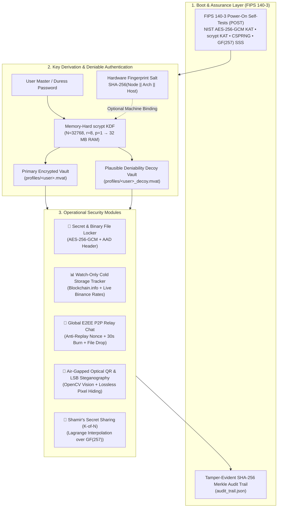

# 🛡️ AegisVault v4.0.0 — Zero-Trust, Post-Quantum Cold Storage & Air-Gapped Privacy Workstation

[](https://github.com/yiitpepek/AegisVault/releases)
[](https://www.python.org/)
[-10b981?style=for-the-badge)](https://csrc.nist.gov/publications/detail/sp/800-38d/final)
[-f59e0b?style=for-the-badge)](https://datatracker.ietf.org/doc/html/rfc7914)
[](https://csrc.nist.gov/publications/detail/fips/140/3/final)
[](LICENSE)

**AegisVault** is an all-in-one, zero-trust cryptographic workstation engineered for **high-assurance cold storage**, **deniable encryption**, **air-gapped optical/steganographic data transport**, and **serverless end-to-end encrypted (E2EE) tactical communications**.

Designed around the **NSA Commercial National Security Algorithm (CNSA) Suite**, **NIST SP 800-38D**, **RFC 7914 (`scrypt`)**, and **Bitcoin BIP-38 / BIP-39** standards, AegisVault eliminates single points of failure across storage, memory, physical coercion, and network transport.

---

## 📑 Table of Contents

1. [Architectural Overview](#-architectural-overview)
2. [Core Cryptographic & Tactical Modules](#-core-cryptographic--tactical-modules)
3. [Mathematical Foundations & Cryptographic Primitives](#-mathematical-foundations--cryptographic-primitives)
4. [Binary Capsule & Wire Protocol Specifications](#-binary-capsule--wire-protocol-specifications)
5. [Threat Model & Defense-in-Depth Matrix](#-threat-model--defense-in-depth-matrix)
6. [Repository Structure](#-repository-structure)
7. [Installation, Usage & Compilation](#-installation-usage--compilation)
8. [Automated Self-Tests & Verification](#-automated-self-tests--verification)

---

## 🏗️ Architectural Overview



---

## 🚀 Core Cryptographic & Tactical Modules

### 1. 🔑 Zero-Trust Cold Storage Vault & Binary File Locker ([`military_vault.py`](military_vault.py), [`vault_storage.py`](vault_storage.py))
* **Authenticated Encryption (AEAD):** Every secret, seed phrase, private key, and embedded binary document (PDF, Office, keystores up to 15 MB) is sealed with **AES-256-GCM** using a unique 96-bit CSPRNG nonce and a 128-bit Galois (`GHASH`) authentication tag.
* **Header-Bound AAD:** The 45-byte binary header (`MVAULT` magic bytes, version, KDF parameters, 128-bit salt, 96-bit nonce) is cryptographically bound as **Associated Authenticated Data (AAD)**. Modifying a single bit of the KDF cost parameters or header metadata immediately invalidates the GCM tag prior to plaintext release.
* **One-Click Encrypted `.mvat` Backup & Restore:** Export portable encrypted snapshots or import external profiles directly from the vault toolbar.

### 2. 🎭 Plausible Deniability / Duress Mode ([`vault_storage.py`](vault_storage.py), [`app.py`](app.py))
* **Defeating Physical Coercion (*The \$5 Wrench Attack*):** Each profile supports an optional secondary **Duress Password**.
* **Zero UI Leakage:** Unlocking with the duress password decrypts an isolated `_decoy.mvat` container pre-populated with innocuous credentials. The application interface renders the exact same green **`● AES-256-GCM | ACTIVE`** status badge and logs an identical `VAULT_UNLOCK` audit event—making it mathematically and visually impossible for an adversary to detect that a secondary vault is active.

### 3. 💻 Hardware Fingerprint & 🔑 512-Bit 2FA USB Keyfile Binding ([`vault_storage.py`](vault_storage.py))
* **Hardware Fingerprint Binding:** Optional machine-binding mixes a deterministic 96-bit SHA-256 hardware fingerprint (`|HW:<digest>`) derived from the host architecture and node identity into the `scrypt` password input.
* **512-Bit CSPRNG 2FA USB Keyfile (`.akey`):** Users can generate a 512-bit hardware-random cryptographic token (`.akey`) stored on an external USB flash drive (or select any existing keyfile). Its 256-bit `SHA3-256` digest (`|KF:<digest>`) is mixed into the `scrypt` key derivation, enforcing true multi-factor physical authentication.

### 4. 💬 Global Serverless E2EE P2P Chat & ⚛️ Post-Quantum Hybrid KEM ([`live_p2p_chat.py`](live_p2p_chat.py), [`crypto_utils.py`](crypto_utils.py))
* **Zero-Knowledge Blinded MQTT Topics:** Room names are never transmitted in plaintext to the relay broker. Instead, peers derive a blinded topic path via `HMAC-SHA256(room_key, "AEGIS-ZK-ROOM-v3:" + room_name)`, preventing metadata harvesting or topic flooding by outsiders.
* **⚛️ Post-Quantum Hybrid KEM Ratcheting (`X25519 + Ring-LWE`):** One-click **PQ-KEM Quantum Handshake** performs an ephemeral key exchange combining classical **X25519 ECDH** with lattice-based **Ring-LWE over $\mathbb{Z}_{3329}[X]/(X^{256}+1)$** (NIST FIPS 203 ML-KEM prime $q=3329$) and **HKDF-SHA512**, ratcheting the session key against *Harvest Now, Decrypt Later* quantum adversaries.
* **Cryptographic Anti-Replay Defense:** Each message envelope embeds a 128-bit CSPRNG `nonce` and Unix `epoch`. Peers enforce a 512-entry sliding-window deduplication cache and a $\pm 600\text{s}$ freshness window, silently dropping replayed ciphertexts.
* **⏱️ 30-Second Burn-After-Reading & 📎 Encrypted File Drop:** Ephemeral tactical messages (`[BURNT-30]`) self-destruct after 30 seconds, while `[FILE-DROP]` transfers end-to-end encrypted binary files up to 1.5 MB (1536 KB) with strict path-traversal sanitization and HiveMQ broker packet optimization.

### 5. 📲 Air-Gapped Optical QR & LSB Image Steganography ([`airgap_crypto.py`](airgap_crypto.py), [`steganography.py`](steganography.py))
* **Optical QR Transceiver:** Encodes AES-256-GCM ciphertexts into high-density optical QR matrices for transmission across physically air-gapped machines (no Wi-Fi, Bluetooth, or USB). Decodes incoming QR frames via OpenCV (`cv2.QRCodeDetector`) with Unicode-safe `numpy.fromfile` I/O.
* **🖼️ High-Speed LSB Image Steganography:** Hides AES-256-GCM encrypted payloads inside the Least Significant Bits (LSB) of RGB pixels in ordinary photographs (PNG/BMP/JPG $\rightarrow$ lossless PNG). Utilizes direct C-buffer `bytearray` manipulation to embed/extract payloads in **$<10\text{ ms}$** even on 24 MP images while remaining visually indistinguishable from the original cover photo.

### 6. 🧩 Shamir's Secret Sharing ($K$-of-$N$) ([`crypto_utils.py`](crypto_utils.py))
* Splits critical secrets (e.g., 24-word BIP-39 mnemonics) into $N$ cryptographic shares where any $K$ shares reconstruct the secret, while $K-1$ shares reveal **zero information-theoretic knowledge**.

### 7. 📊 Watch-Only Cold Storage Portfolio ([`crypto_portfolio.py`](crypto_portfolio.py))
* Validates public wallet address formats and checksums (**Bitcoin** Legacy/P2SH/Bech32/Taproot, **Ethereum** EIP-55 hex, **Solana** Base58) without ever requesting private keys.
* Queries live on-chain Bitcoin balances from `blockchain.info` and real-time `BTCUSDT`, `ETHUSDT`, `SOLUSDT`, and dynamic `USDTTRY` exchange rates from the Binance REST API on non-blocking background threads.

### 8. 🛡️ FIPS 140-3 POST, Dead-Man's Switch & Scorched-Earth Zeroization ([`military_audit.py`](military_audit.py), [`vault_storage.py`](vault_storage.py))
* **6-Vector Power-On Self-Tests (POST):** At startup, executes 6 deterministic Known-Answer & Integrity Tests before allowing vault operations:
  1. **NIST SP 800-38D AES-256-GCM KAT**
  2. **`scrypt` Memory-Hard KDF Determinism Test**
  3. **OS CSPRNG Hardware Entropy Health Check**
  4. **Shamir $\mathbb{F}_{257}$ Lagrange Polynomial Reconstruction KAT**
  5. **Post-Quantum Hybrid KEM (`X25519 + Ring-LWE q=3329`) Roundtrip KAT**
  6. **Zero-Trust Anti-Backdoor AST Scanner & `SHA3-256` Runtime Codebase Shield**
* **💀 Dead-Man's Switch & Scorched-Earth Brute-Force Wipe:**
  * Configurable **Inactivity Auto-Wipe Timer** (`7 / 30 / 90 / 180 Days`) and **Persistent Brute-Force Self-Destruct Threshold** (`10 / 15 / 25 Attempts`) sealed on disk with a hardware-bound `HMAC-SHA256` tag.
  * When triggered, automatically executes **3-Pass DoD 5220.22-M sanitization** (`0x00` zeroes, `0xFF` complement, CSPRNG stream + `os.fsync`) and shreds the vault files.
* **Tamper-Evident Merkle Audit Trail & Panic Controls:**
  * Chains every security event with SHA-256 hashes ($H_i = \text{SHA256}(\text{Index}_i \parallel \text{Timestamp}_i \parallel \text{Event}_i \parallel H_{i-1})$).
  * **`Ctrl + Shift + L` Global OS-Level Panic Hotkey** & **30-Second Clipboard Auto-Scrubber** immediately purge secrets from RAM and the OS clipboard even when minimized or in the background.

---

## 📐 Mathematical Foundations & Cryptographic Primitives

### 1. Memory-Hard Key Derivation (`scrypt` — RFC 7914)
To neutralize custom ASIC and multi-GPU cracking rigs, master keys are derived via `scrypt` with parameters $N = 2^{15} = 32768$, $r = 8$, $p = 1$:

$$K_{\text{AES}} = \text{scrypt}\left(P_{\text{eff}}, S_{128}, N=2^{15}, r=8, p=1, \text{dkLen}=32\right) \in \{0,1\}^{256}$$

Each key derivation requires sequential read/write access over an internal RAM matrix of size:

$$M = 128 \times N \times r = 128 \times 32768 \times 8 = 33,554,432 \text{ bytes } (32 \text{ MB})$$

Prior to derivation during decryption, untrusted header parameters are strictly bounded ($\log_2 N \in [10, 20]$, $r \in [1, 32]$, $p \in [1, 16]$, $M \le 512\text{ MB}$) to prevent Out-Of-Memory (OOM) Denial-of-Service attacks.

### 2. Authenticated Encryption (AES-256-GCM — NIST SP 800-38D)
Encryption operates in Counter Mode (`CTR`) paired with universal hashing (`GHASH`) over the binary Galois Field $\mathbb{F}_{2^{128}}$ defined by the irreducible polynomial:

$$f(x) = x^{128} + x^7 + x^2 + x + 1$$

Given the 256-bit key $K_{\text{AES}}$, 96-bit CSPRNG nonce $IV \in \{0,1\}^{96}$, 45-byte header $A$ (AAD), and plaintext $P$:

$$(C, T) = \text{AES-256-GCM-Enc}(K_{\text{AES}}, IV, P, A), \quad T \in \{0,1\}^{128}$$

### 3. Shamir's Secret Sharing over Prime Field $\mathbb{F}_{257}$
Why $\mathbb{F}_{257}$ instead of $\mathbb{F}_{256}$? Because $257$ is a Fermat prime ($2^8 + 1$), every non-zero element has a unique multiplicative inverse modulo $257$ without lookup tables. For each secret byte $a_0 \in [0, 255]$, $K-1$ uniform random coefficients $a_1, \dots, a_{K-1} \xleftarrow{\$} [0, 256]$ define the polynomial:

$$P(x) = \left( a_0 + \sum_{m=1}^{K-1} a_m x^m \right) \bmod 257$$

Rejection sampling ensures $P(x) \in [0, 255]$ for all share coordinates $x \in \{1, \dots, N\}$, guaranteeing 1:1 byte packing. Given any $K$ shares $\{(x_0, y_0), \dots, (x_{K-1}, y_{K-1})\}$, Lagrange interpolation at $x = 0$ recovers $a_0$:

$$a_0 = P(0) = \left( \sum_{i=0}^{K-1} y_i \prod_{\substack{j=0 \\ j \neq i}}^{K-1} \left( -x_j \right) \cdot \left( x_i - x_j \right)^{-1} \right) \bmod 257$$

where $\left(x_i - x_j\right)^{-1} \equiv \left(x_i - x_j\right)^{255} \pmod{257}$ via Fermat's Little Theorem (`pow(den, -1, 257)`).

### 4. Post-Quantum Hybrid Key Encapsulation ($\mathcal{R}_{3329} = \mathbb{Z}_{3329}[X]/(X^{256}+1)$ + X25519)
To protect against Shor's algorithm on future quantum computers, `PQHybridKEM` operates over the cyclotomic polynomial ring $\mathcal{R}_q = \mathbb{Z}_{3329}[X]/(X^{256}+1)$ with $q = 3329$ and bounded ternary secrets $s, e, r, e_1, e_2 \in \{-1, 0, 1\}^{256}$:

$$b(X) = a(X) \cdot s(X) + e(X) \pmod{X^{256}+1, 3329}$$

$$u(X) = a(X) \cdot r(X) + e_1(X), \quad v(X) = b(X) \cdot r(X) + e_2(X) + \left\lfloor \frac{q}{2} \right\rceil \cdot m(X)$$

Because $\|e \cdot r - s \cdot e_1 + e_2\|_\infty \le 513 < \lfloor q/4 \rfloor = 832$, decapsulation of the 256-bit quantum secret $m$ has **zero mathematical failure probability** and is combined with classical X25519 ECDH via `HKDF-SHA512`:

$$K_{\text{PQ}} = \text{HKDF-SHA512}\left(Z_{\text{X25519}} \parallel m, \text{salt}=\text{SHA3-256}(\text{transcript})\right)$$

---

## 📦 Binary Capsule & Wire Protocol Specifications

### 1. `.mvat` Vault Capsule Header (45 Bytes, Big-Endian `>6sBBBII16s12s`)

```text
+---------------+---------------+---------------+---------------+
| Byte 0..5     | Byte 6        | Byte 7        | Byte 8        |
| Magic: MVAULT | Version: 0x01 | KDF: 0x01     | log2(N): 15   |
+---------------+---------------+---------------+---------------+
| Byte 9..12                    | Byte 13..16                   |
| scrypt r (uint32 = 8)         | scrypt p (uint32 = 1)         |
+-------------------------------+-------------------------------+
| Byte 17..32 (16 Bytes)                                        |
| CSPRNG Salt (128-bit)                                         |
+---------------------------------------------------------------+
| Byte 33..44 (12 Bytes)                                        |
| AES-GCM Nonce / IV (96-bit)                                   |
+---------------------------------------------------------------+
| Byte 45..End                                                  |
| AES-256-GCM Ciphertext + 16-Byte (128-bit) GHASH Auth Tag     |
+---------------------------------------------------------------+
```

### 2. LSB Steganography Pixel Header (11 Bytes, Big-Endian `>6sBI`)
Embedded across the first $11 \times 8 = 88$ RGB channel bytes ($b_{\text{new}} = (b_{\text{orig}} \ \& \ \sim 1) \mid \text{bit}_i$):
* `Magic` (6 Bytes): `AGSTEG`
* `Version` (1 Byte): `0x01`
* `Payload Length` (4 Bytes `uint32`): Byte length of the embedded UTF-8 or `AEGIS-MSG-v1` encrypted payload.

---

## 🛡️ Threat Model & Defense-in-Depth Matrix

| Threat Vector | Adversary Capability | AegisVault Countermeasure |
| :--- | :--- | :--- |
| **Quantum Decryption (CRQC)** | *Harvest Now, Decrypt Later* via Shor's/Grover's | **Post-Quantum Hybrid KEM** (`X25519 + Ring-LWE q=3329 + HKDF-SHA512`) + 256-bit AES-GCM. |
| **Offline GPU/ASIC Cracking** | Stolen `.mvat` file + multi-GPU hashcat cluster | `scrypt` (32 MB RAM/guess) + **96-bit Hardware Binding** + **512-bit 2FA USB Keyfile (`.akey`)**. |
| **Persistent Brute-Force / Seizure** | Repeated offline/online password guessing or prolonged seizure | **Dead-Man's Switch** (7–180d inactivity wipe) + **Scorched-Earth Brute-Force Wipe** (3-pass DoD 5220.22-M). |
| **Physical Coercion (\$5 Wrench)** | Attacker forces user to unlock vault in person | **Duress Password** opens realistic Decoy Vault with identical UI badges and identical audit trail logs. |
| **Sudden Physical Intrusion** | Shoulder-surfing or device seizure while unlocked | **`Ctrl+Shift+L` OS-Level Global Panic Hotkey** (`RegisterHotKey` + Tkinter hook) + 120s inactivity auto-lock immediately wipes RAM keys and system clipboard. |
| **Clipboard Malware / Stealers** | Background spyware monitoring OS clipboard | **30-Second Ephemeral Clipboard Scrubber** automatically purges copied secrets after 30s or upon vault lock. |
| **Network MITM, Replay & Metadata** | Compromised MQTT broker or ISP packet sniffing | **Zero-Knowledge HMAC-Blinded Topics** + AES-256-GCM + 128-bit CSPRNG `nonce` replay cache. |
| **Supply-Chain / RCE / Backdoors** | Malicious update redirection or code injection | **HTTPS Domain Allowlist + PE `MZ` & SHA-256 Check** + **Boot-Time AST Anti-Backdoor & `SHA3-256` Shield**. |
| **Malformed Packet OOM DoS** | Attacker sends crafted header with $r=2^{30}$ | Strict pre-authentication bounds check ($\log_2 N \le 20, r \le 32, p \le 16$, RAM $\le 512\text{ MB}$). |
| **Forensic Disk Inspection** | Deep inspection for encrypted containers | **LSB Image Steganography** conceals AES-256-GCM ciphertexts inside ordinary lossless PNG photographs. |

---

## 📂 Repository Structure

```text
AegisVault/
├── app.py                # Main CustomTkinter GUI, navigation controller, async workers & panic lock
├── military_vault.py     # Core AES-256-GCM + scrypt AEAD cryptographic engine & RAM zeroizer
├── vault_storage.py      # Multi-user profile manager, hardware fingerprinting, decoy vault & atomic I/O
├── military_audit.py     # FIPS 140-3 POST KAT suite, SHA-256 Merkle audit trail & DoD 5220.22-M shredder
├── crypto_utils.py       # Shamir's Secret Sharing over GF(257), BIP-39 validator & Shannon entropy meter
├── crypto_chat.py        # AEGIS-MSG-v1 E2EE envelope serializer with 128-bit anti-replay nonces
├── live_p2p_chat.py      # Global serverless MQTT relay client with sliding-window replay defense
├── airgap_crypto.py      # Air-gapped high-density QR generator & Unicode-safe OpenCV decoder
├── steganography.py      # High-speed bytearray LSB image steganography encoder & extractor
├── crypto_portfolio.py   # Watch-only BTC/ETH/SOL validator, Blockchain.info & live Binance USD/TRY rates
├── updater.py            # SemVer-aware GitHub Releases auto-updater & binary hot-swapper
├── i18n.py               # Complete trilingual localization dictionary (Turkish, English, Russian)
└── requirements.txt      # Python package dependencies
```

---

## ⚙️ Installation, Usage & Compilation

### Option 1: Standalone Windows Executable (Zero Dependencies)
Download the latest `AegisVault.exe` from the [**GitHub Releases**](https://github.com/yiitpepek/AegisVault/releases) page and launch directly:
```powershell
.\AegisVault.exe
```

### Option 2: Run from Python Source
```bash
git clone https://github.com/yiitpepek/AegisVault.git
cd AegisVault
pip install -r requirements.txt
python app.py
```

### Option 3: Compile Standalone `.exe` via PyInstaller
```powershell
pip install pyinstaller -r requirements.txt
pyinstaller --noconsole --onefile --clean --name "AegisVault" --collect-all customtkinter --collect-all paho --collect-all qrcode --collect-all cv2 --collect-all PIL app.py
```

---

## 🧪 Automated Self-Tests & Verification

You can run the built-in cryptographic verification suite directly from the terminal to validate NIST SP 800-38D vectors, bit-flip tamper rejection, and FIPS 140-3 POST modules:

```bash
python military_vault.py
```

Expected output:
```text
=================================================================
 MILITARY-GRADE VAULT SECURITY & INTEGRATION TEST
=================================================================
[+] Step 1: Encrypting Bitcoin Seed Phrase...
[+] Step 2: Decrypting with correct password...
    [PASSED] Data decrypted successfully and verified.
[+] Step 3: Testing with incorrect password...
    [PASSED] Wrong password immediately rejected (Auth Tag Mismatch).
[+] Step 4: Testing bit-flip tampering attack...
    [PASSED] 1-bit tampering detected by AEAD and operation aborted.
=================================================================
 ALL CRYPTOGRAPHIC STANDARDS VERIFIED SUCCESSFULLY!
=================================================================
```

---

## 📄 License

Distributed under the **MIT License**. Engineered for security research, cryptographic education, and sovereign cold-storage asset protection.
